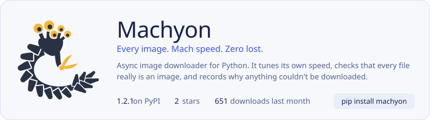
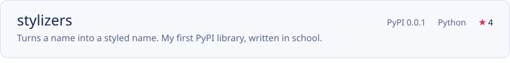
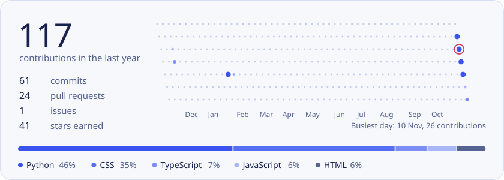

<picture>
  <source media="(prefers-color-scheme: dark)" srcset="https://raw.githubusercontent.com/DivyanshuSingh96/DivyanshuSingh96/output/header-dark.svg">
  
</picture>

I build things that have to be secure and fast at the same time. Right now that's a post-quantum protocol for connected vehicles, semantic search that answers in under 3 ms on a CPU, and Machyon, an image downloader I spent a year getting right.

Say hello on [LinkedIn](https://linkedin.com/in/divyanshu-singh-pythonista) or at [divyanshu.singh144400@gmail.com](mailto:divyanshu.singh144400@gmail.com).

## What I've shipped

<a href="https://github.com/DivyanshuSingh96/machyon">
  <picture>
    <source media="(prefers-color-scheme: dark)" srcset="https://raw.githubusercontent.com/DivyanshuSingh96/DivyanshuSingh96/output/machyon-dark.svg">
    
  </picture>
</a>

Machyon started in the Amazon ML Challenge, when downloading 263,859 images cost my team hours we didn't have. [Read the docs](https://divyanshusingh96.github.io/machyon/) or meet [Opa](https://divyanshusingh96.github.io/machyon/project/meet-opa/), its five-eyed mascot.

<a href="https://github.com/DivyanshuSingh96/AiMi-Anime-RAG-System">
  <picture>
    <source media="(prefers-color-scheme: dark)" srcset="https://raw.githubusercontent.com/DivyanshuSingh96/DivyanshuSingh96/output/project-aimi-anime-rag-system-dark.svg">
    
  </picture>
</a>
<a href="https://github.com/DivyanshuSingh96/AnimeX">
  <picture>
    <source media="(prefers-color-scheme: dark)" srcset="https://raw.githubusercontent.com/DivyanshuSingh96/DivyanshuSingh96/output/project-animex-dark.svg">
    
  </picture>
</a>
<a href="https://github.com/DivyanshuSingh96/stylizers">
  <picture>
    <source media="(prefers-color-scheme: dark)" srcset="https://raw.githubusercontent.com/DivyanshuSingh96/DivyanshuSingh96/output/project-stylizers-dark.svg">
    
  </picture>
</a>

## Tools I reach for

**Machine learning:** Python, PyTorch, TensorFlow, scikit-learn, OpenCV 
**Backend:** FastAPI, Django, PostgreSQL, Redis, Docker, AWS, Linux 
**Everyday:** Git, VS Code, Vim, Bash, Figma

## The last year on GitHub

<picture>
  <source media="(prefers-color-scheme: dark)" srcset="https://raw.githubusercontent.com/DivyanshuSingh96/DivyanshuSingh96/output/activity-dark.svg">
  
</picture>

Cards are drawn by <a href=".github/workflows/profile.yml">a GitHub Action</a> every morning, set in <a href="https://github.com/ateliertriay/bricolage">Bricolage Grotesque</a>.
